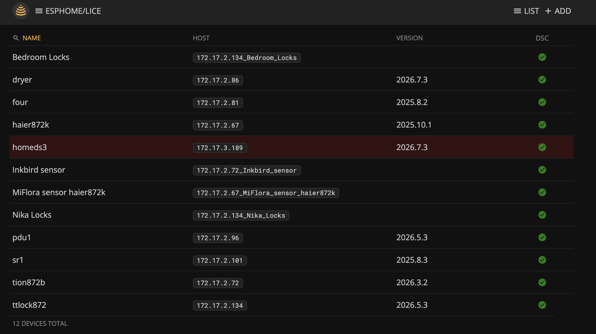
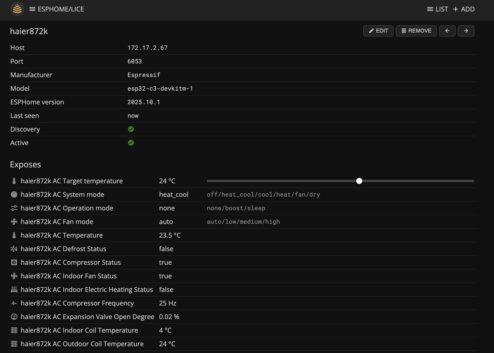

# HOMEd ESPHome

A [HOMEd](https://wiki.homed.dev/) service that integrates ESPHome devices into the HOMEd ecosystem via the ESPHome Native API. Device entities are exposed to MQTT in the same format as other HOMEd services.

Devices are added and removed at runtime via MQTT commands. On each connection the service discovers all exported entities from the device and updates the database automatically.

## Supported entities

| ESPHome type    | Description                                      |
|-----------------|---------------------------------------------------|
| `switch`        | On/off control, reports `status` (on/off)        |
| `binary_sensor` | Read-only boolean sensor (motion, contact, etc.) |
| `cover`         | Open/close/stop, position (if supported by the device) |
| `sensor`        | Numeric sensor (temperature, humidity, etc.)     |
| `text_sensor`   | String-valued sensor                             |
| `light`         | On/off, brightness, RGB color, color temperature |
| `climate`       | Mode, target temperature, fan mode, preset       |
| `lock`          | Lock/unlock, reports `status` (`off`=locked, `on`=unlocked) |
| `select`        | Dropdown selection with enumerated options       |
| `number`        | Numeric input with min/max/step constraints      |
| `button`        | Momentary trigger (press only)                   |

`cover` and `climate` entities without native ESPHome support for a given feature (e.g. tilt, dual-point target temperature, swing mode) fall back to sane defaults rather than being exposed — see the inline comments in `esphome.cpp` for exactly what's covered.

`switch` entities with `entity_category: config` or `entity_category: diagnostic` set in the ESPHome YAML aren't treated as one of a device's primary functions — they're exposed as a plain `toggle` control alongside the device's other simple exposes (`select`/`number`/`button`) instead of getting the full switch treatment (its own numbered slot, HA discovery as a `switch` entity, on/off/toggle status). Switches without an `entity_category` (the default) are unaffected.

## Sub-devices

ESPHome devices that group entities under [sub-devices](https://esphome.io/components/index.html#devices) are published as separate HOMEd devices rather than as endpoints of the parent, one per sub-device — address `<parent address>_<sub-device name>`, model `Subdev <sub-device name> of <parent name>`. They share the parent's connection (no separate TCP connection, no separate `addDevice`), and are (re)discovered automatically alongside it.

Native API states and commands are routed by the pair `device_id` + entity `key`. The protocol `device_id` is refreshed during discovery and is not used as the persistent HOMEd identity, so reordering sub-devices does not change their addresses.

A sub-device that stops being reported (removed from the ESPHome config, or the parent simply offline) is never deleted on its own — it's left in the database exactly as last seen, so if it's ever reconfigured back it picks up its previous `objectId`/expose mapping again rather than starting over as a new device. Only an explicit `removeDevice` command deletes it — and removing a parent this way also removes its sub-devices, since they can't function without it.

Names adopted automatically from ESPHome are made unique with a numeric suffix such as `Room (2)` if needed. Sub-device display names can be edited independently of their stable addresses; rediscovery does not overwrite the user's name.

## Active devices

Inactive devices reject commands, publish no `fd` readings and report offline. Disabling a parent closes its connection and stops retries; all its sub-devices become unavailable, but keep their individual Active settings. Cached readings from the closed connection are discarded. Re-enabling the parent reconnects and obtains fresh states.

Disabling just a sub-device does not interrupt its parent or siblings. Incoming data may still refresh its internal cache, but is not published until it is enabled again. A sub-device cannot operate while its parent is inactive or missing.

## Home Assistant discovery cleanup

The database keeps a per-device history of HA config topics (`haDiscoveryTopics`). After a complete entity discovery, topics not in the current entity set are cleared with empty retained payloads, including old component topics when an entity changes type. Disabling device discovery or removing a device clears all known config topics. A still-declared sub-device with no entities receives an empty entity snapshot, so its old configs are cleared without deleting the device. Entirely unreported sub-devices retain their cached descriptions as before.

Topic history is saved before publication and retained as cleanup markers, so deletes can be retried after MQTT reconnects or the service restarts. Historical entries are not pruned on send because sending does not acknowledge broker receipt. At startup, older databases seed the history from a valid restored entity cache before live discovery replaces it. Already-orphaned topics absent from both the cache and the history cannot be reconstructed automatically.

## Connection deadlines

After the Noise handshake, the service allows 60 seconds for the API exchange (`HelloResponse`, `DeviceInfoResponse` and the entity list ending in `ListEntitiesDone`). This is an absolute deadline: partial entity lists and other traffic do not extend it. The device is marked online only when discovery completes.

After discovery, a ping is sent every 60 seconds. Its `PingResponse` must arrive within 15 seconds; state updates and incoming server pings do not extend this deadline. Server `PingRequest` messages receive a `PingResponse` without acknowledging our own outstanding ping.

Either timeout aborts the socket, marks the parent and its sub-devices offline, and schedules the normal retry after 10 seconds while the parent remains active. Disconnecting stops both deadline timers.

## State values

ESPHome state responses are snapshots: omitted proto3 values mean zero, false or an empty string, not the previous reading. Optional light and climate readings are defaulted only when supported. Modern cover position defaults to zero (closed), including open/close-only covers.

A reported `missing_state` invalidates that entity's cached readings and publishes JSON `null`, rather than inventing a zero/off reading or retaining an old value. Lock states other than confirmed locked/unlocked are also published as `null`. The device itself can remain online while an entity has no valid reading.

## Entity cache

After discovery, the database stores a versioned entity snapshot with exact endpoint IDs, special/common routing, expose metadata and device options. This restores the same entity descriptions on restart even when the ESPHome device is offline. Protocol `device_id` values and live readings are not restored from disk.

Older database records lack enough information for a faithful reconstruction. They are preserved until the device reconnects and discovery writes the new snapshot. Until then, the service does not overwrite retained expose/HA descriptions with incomplete cached data; if the broker has no retained descriptions, they become available after discovery. Invalid or unsupported snapshots are handled the same way.

## Web UI

~~`homed-web` needs to be patched to add ESPHome support, after installing, run: `/usr/share/homed-web/esphome-patcher.sh`~~

Since homed-web version 0.14 no patching is needed.

## Configuration

Edit `/etc/homed/homed-esphome.conf` and adjust the MQTT settings before running.

## Releases

Prebuilt packages are available on the [Releases](https://github.com/bazuchan/homed-service-esphome/releases) page, covering the same platforms as [homed](https://wiki.homed.dev/) itself.

## MQTT commands

See [COMMANDS.md](COMMANDS.md) for the full list of commands and entity control payloads.

## Building

See [BUILDING.md](BUILDING.md) for building instructions.

## Screenshots

